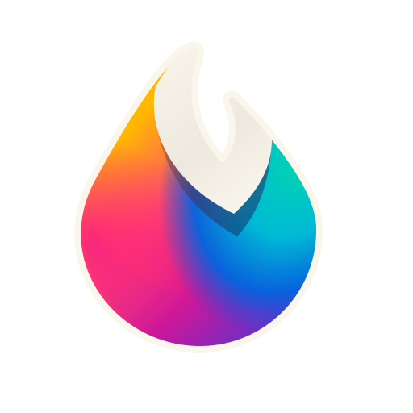
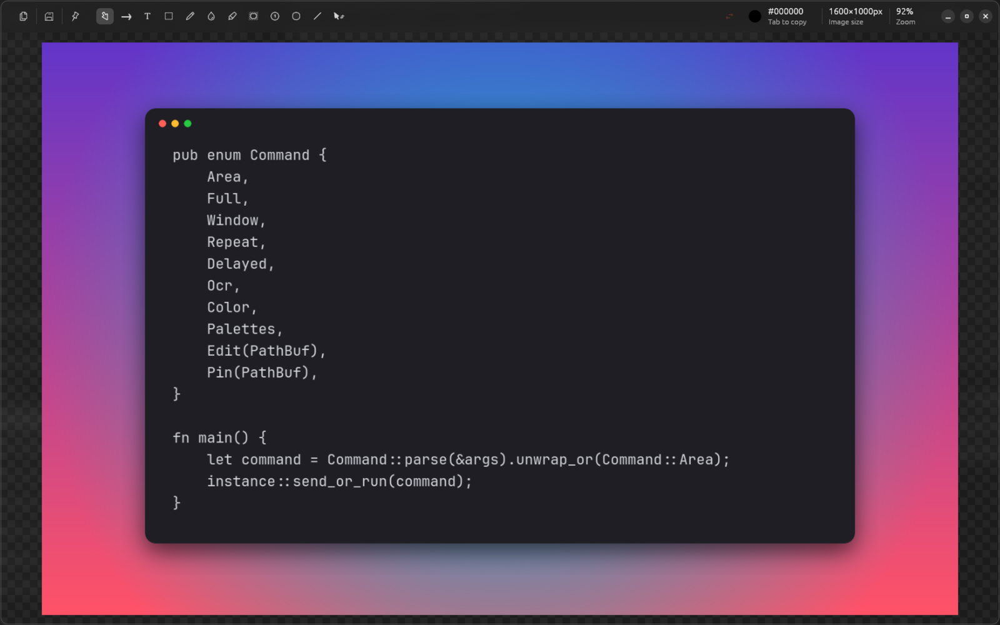
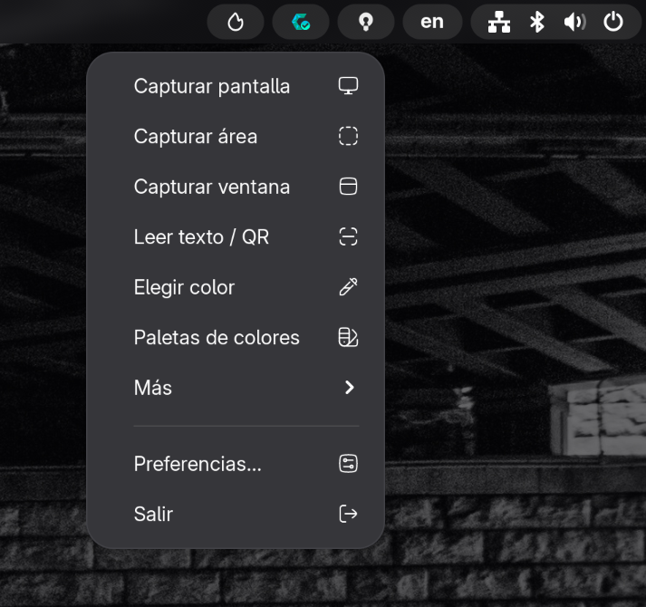
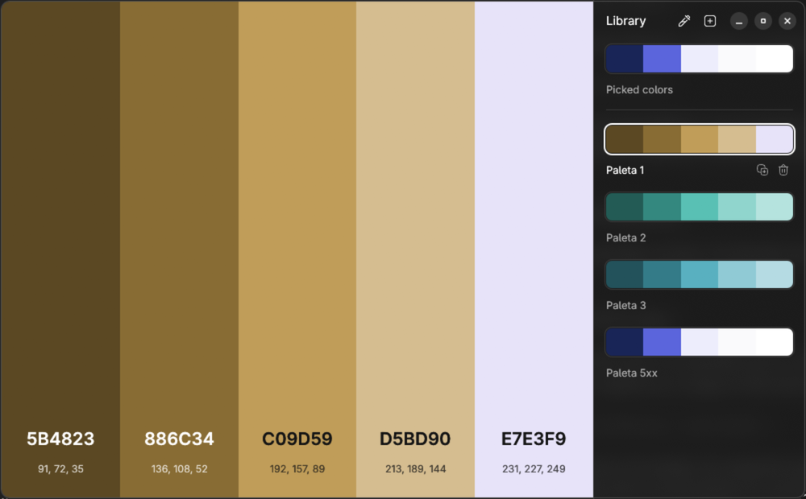
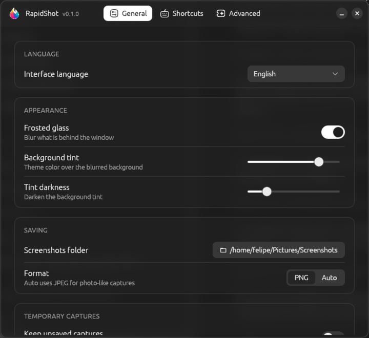
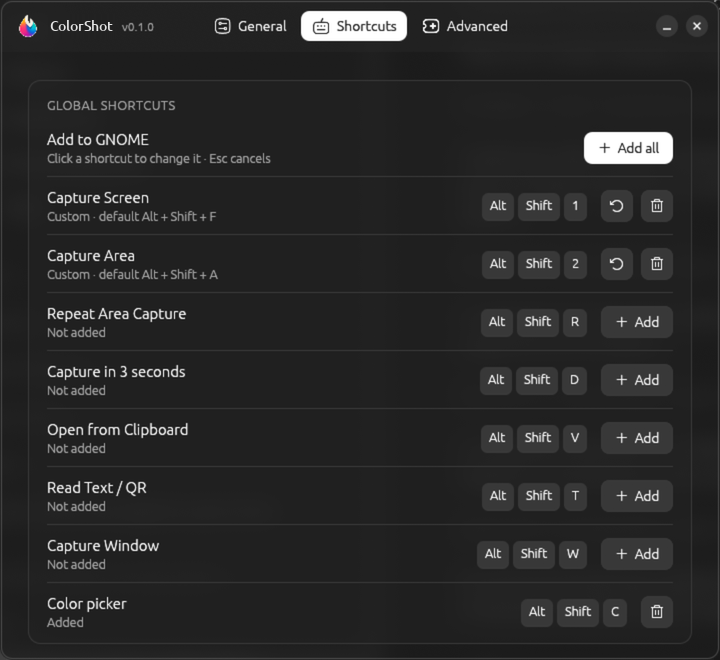
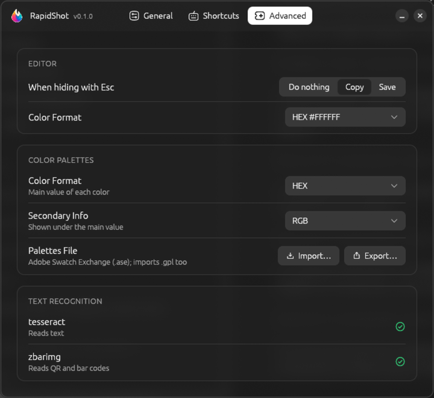

<p align="center">
  
</p>

<h1 align="center">ColorShot</h1>

<p align="center">
  A fast screenshot tool for Linux: capture, annotate, pin, read text and pick colors.<br>
  Built in Rust with egui, made for GNOME on Wayland.
</p>

<p align="center">
  
</p>

## Features

- **Capture**: area, full screen, a single window, a delayed capture (3 s) or a repeat of the
  last area. The area selector has a magnifier, resize handles, arrow-key nudging and works
  across multiple monitors.
- **Floating thumbnail** after each capture: copy, save, edit, pin or drag it away. You choose
  the monitor, the corner and how long it stays.
- **Editor**: arrow, line, text, rectangle, oval, freehand draw, highlighter, blur / erase,
  spotlight, numbered counter, crop and resize. Shapes stay editable (select, move, restyle,
  undo / redo), and each tool remembers its last color, width and style.
- **Image info** in the toolbar: color under the cursor (copy it with <kbd>Tab</kbd> in HEX,
  RGB, HSL and more), image size and zoom. With an area selected: autoadjust, size label and the
  WCAG contrast between its two main colors.
- **Pin** any capture as an always-on-top window, with opacity and zoom.
- **Read text and QR codes** from an area (OCR with Tesseract, QR with ZBar) and copy them.
- **Color picker** and a **color palette library**: save, reorder, generate shades and
  import / export Adobe Swatch Exchange (`.ase`) and GIMP (`.gpl`) files.
- **Global shortcuts** registered in GNOME from the preferences window.
- **Tray menu** with every action (**More** has repeat, delayed capture, **Default Folder** and
  **Edit Last**, which opens the latest capture in the editor), a single resident instance and a
  CLI.
- Interface in English, Spanish, Portuguese, French, German, Russian, Chinese and Japanese.

## Screenshots

| Tray menu | Color palettes |
| --- | --- |
|  |  |

| Preferences | |
| --- | --- |
|  |  |
|  | |

## Requirements

- GNOME 45 or newer (developed and tested on Wayland). Captures go through the XDG desktop portal.
- [Rust](https://rustup.rs) (stable) and [just](https://github.com/casey/just) to build.
- Optional tools, used when present:

| Tool | Used for |
| --- | --- |
| `wl-clipboard` | Copy and paste images on Wayland |
| `tesseract` (+ language data) | Read text |
| `zbar` (`zbarimg`) | Read QR and bar codes |
| `zenity` | "Open File" dialog |
| `libnotify` (`notify-send`) | Notifications |

<details>
<summary>Install dependencies</summary>

| Distro | Command |
| --- | --- |
| Fedora | `sudo dnf install wl-clipboard tesseract zbar zenity libnotify` |
| Arch Linux | `sudo pacman -S wl-clipboard tesseract tesseract-data-eng zbar zenity libnotify` |
| Ubuntu/Debian | `sudo apt install wl-clipboard tesseract-ocr zbar-tools zenity libnotify-bin` |
| openSUSE | `sudo zypper install wl-clipboard tesseract-ocr tesseract-ocr-traineddata-english zbar zenity libnotify-tools` |

Add more Tesseract languages with your distro's language packs (for example
`tesseract-langpack-spa`, `tesseract-data-spa`, `tesseract-ocr-spa` or
`tesseract-ocr-traineddata-spanish` for Spanish).

</details>

## Install

Install or update to the latest release (x86_64, no root needed):

```bash
curl -fsSL https://raw.githubusercontent.com/wfpaisa/colorshot/main/install.sh | bash
```

It installs:

- `~/.local/bin/colorshot`
- the launcher and its icon (`~/.local/share/applications/colorshot.desktop`)
- the interface icons (`~/.local/share/colorshot/icons`)
- the GNOME Shell extension `colorshot@wfelipe.com`

Log out and back in once so GNOME loads the extension. It is needed for **Capture Window**,
for drawing the selector over the top bar and for capturing only the chosen area.

Pick a version with `bash -s -- --version v0.1.0`. You can also download the archive from
[Releases](https://github.com/wfpaisa/colorshot/releases), extract it and run `./install.sh`.

### Uninstall

```bash
curl -fsSL https://raw.githubusercontent.com/wfpaisa/colorshot/main/install.sh | bash -s -- --uninstall
```

It stops the running instance and removes the binary, the launcher, the icons and the GNOME
Shell extension. Your settings in `~/.config/colorshot` are kept; delete that folder to remove
them too. From an extracted archive or a clone, run `./install.sh --uninstall` instead.

### From source

```bash
git clone https://github.com/wfpaisa/colorshot.git
cd colorshot
just install
```

## Usage

Start the resident instance (it adds the tray icon):

```bash
colorshot
```

The first time it starts (right after `install.sh`), a welcome guide explains how ColorShot
works, installs and enables the GNOME extension, shows the tray menu with quick settings, adds
the global shortcuts and turns on **Launch at startup**. Open it again from the tray menu (**More → Welcome Guide**) or with
`colorshot welcome`.

Then use the tray menu, the global shortcuts (add them in **Preferences → Shortcuts**), the
launcher menu (right-click ColorShot in the dock or app grid) or the CLI:

```text
colorshot [area | full | window | ocr | color | palettes | repeat | delayed |
           clipboard | open | folder | last | prefs | welcome | edit <file> | pin <file> | quit | --version]
```

| Default shortcut | Action |
| --- | --- |
| <kbd>Alt</kbd> <kbd>Shift</kbd> <kbd>F</kbd> | Capture screen |
| <kbd>Alt</kbd> <kbd>Shift</kbd> <kbd>A</kbd> | Capture area |
| <kbd>Alt</kbd> <kbd>Shift</kbd> <kbd>R</kbd> | Repeat area capture |
| <kbd>Alt</kbd> <kbd>Shift</kbd> <kbd>D</kbd> | Capture in 3 seconds |
| <kbd>Alt</kbd> <kbd>Shift</kbd> <kbd>V</kbd> | Open from clipboard |
| <kbd>Alt</kbd> <kbd>Shift</kbd> <kbd>T</kbd> | Read text / QR |
| <kbd>Alt</kbd> <kbd>Shift</kbd> <kbd>W</kbd> | Capture window |
| <kbd>Alt</kbd> <kbd>Shift</kbd> <kbd>C</kbd> | Color picker |

Settings live in `~/.config/colorshot/`.

## Development

```bash
just dev area   # run a debug build with any subcommand
just test       # cargo test
just lint       # rustfmt + clippy
just release    # portable build in Docker, packaged in dist/
```

The workspace is split into `crates/core` (capture, settings, image, clipboard, OCR),
`crates/ui` (egui windows: selector, editor, thumbnail, pin, preferences, palettes, tray) and
`apps/colorshot` (binary, single instance and CLI). The GNOME extension is in `extension/`.

The interface icons are SVGs in `assets/icons/`; after editing one, run `just icons` and
restart the app, no rebuild needed. The logo (`assets/logo.svg`) is embedded in the binary, so
it needs `just install`.


## Relelease

First commit and push to github all.
```sh
./release.sh          #  0.1.0 → 0.1.1
./release.sh 0.2.0    # use the specific version
``` 

## License

[MIT](LICENSE)
